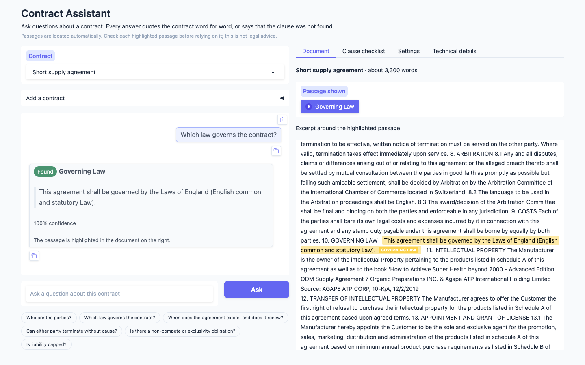
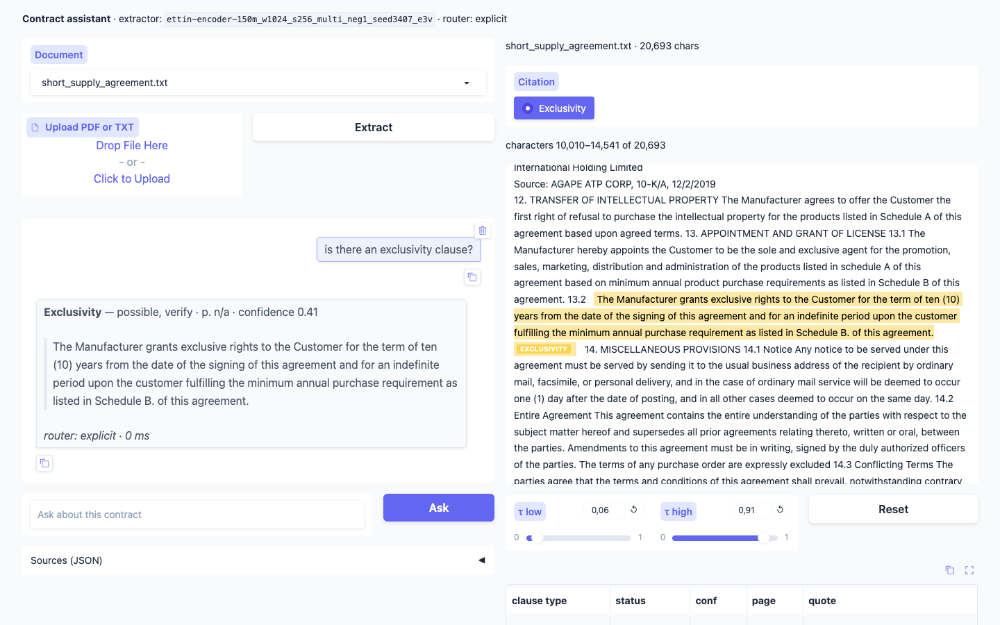
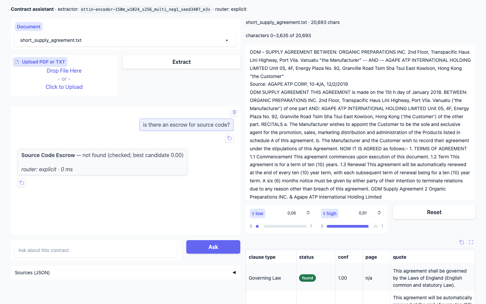
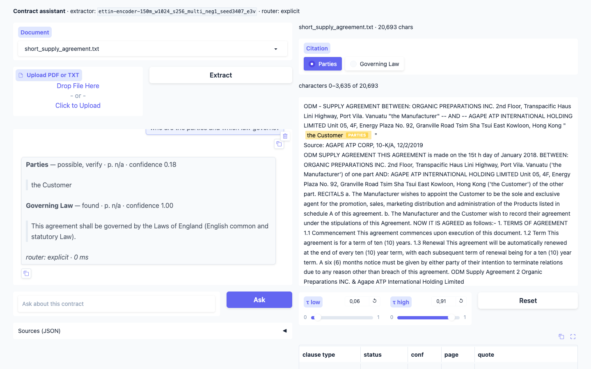
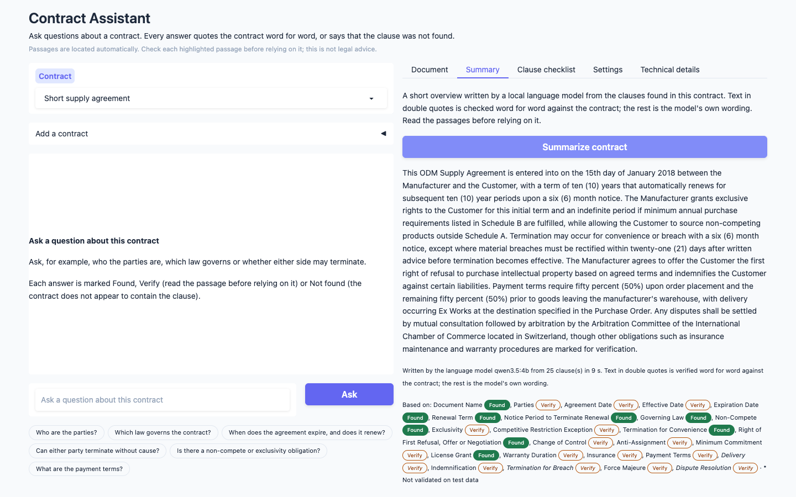
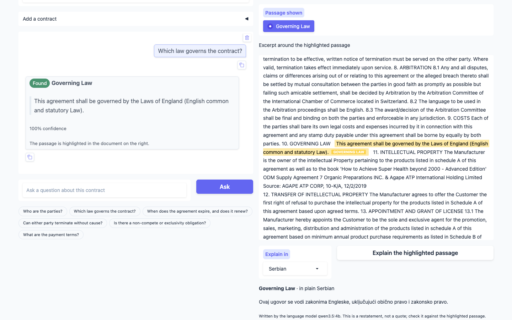

# contract-assistant

A local legal assistant for one contract at a time: upload a contract, ask questions in
plain language, get **verbatim quotes with a page number and a confidence** — or an
explicit *"not found"*.

The expensive model (a fine-tuned 150M-parameter encoder, trained in the companion
`cuad-encoder` repo) runs **once at upload** and extracts all 41 CUAD clause types with
character offsets. Every later question is a cache lookup: a router only maps the question
to clause types and never writes legal content. The router is Qwen3-1.7B served by Ollama,
constrained to the clause type names; without Ollama an embedding router
(bge-base-en-v1.5) routes instead. Quotes are verified against the source text before they
are shown.

The app also checks eight common clause types that CUAD does not have (Payment Terms,
Delivery, Confidentiality, Indemnification, Termination For Breach, Force Majeure, Dispute
Resolution, Data Protection). They are asked with CUAD's question template and the same
extractor, without retraining, and are never marked Found because no gold data exists to
validate their thresholds. A question that matches no clause type gets up to three related
passages of the contract, shown verbatim and labelled as not a clause match.

The app can also write a short summary from the clauses it found and restate one clause in
plain English or Serbian. This text is generated and labelled as such. Quotes inside it are
verified against the contract.

## Install

Python 3.12.

```bash
uv venv && uv pip install -e ".[dev]"     # or: python -m venv .venv && pip install -e ".[dev]"
cp .env.example .env
```

The `api` extra (`openai`) is optional. The Makefile expects the environment in `.venv/`.

The LLM router needs Ollama and the model. This step is optional:

```bash
brew install ollama && brew services start ollama
ollama pull qwen3:1.7b      # qwen3:4b for the comparison row
ollama pull qwen3.5:4b      # summaries and explanations
```

`LLM_BACKEND` in `.env` selects the router: `ollama` (default), `openai` (an
OpenAI-compatible endpoint, set by `OPENAI_BASE_URL`, `OPENAI_API_KEY` and `LLM_MODEL`;
needs the `api` extra) or `none`, which routes with the embedding router only. If Ollama is
not running or the model is not pulled, the app logs a warning and uses the embedding
router alone. When the LLM fails on a single question, the embedding router routes that
question.

`GEN_MODEL` (default `qwen3.5:4b`), `GEN_TIMEOUT_S` (120) and `GEN_NUM_CTX` (8192) select
the generation model. It uses `LLM_BACKEND` like the router. It answers in free text, so it
needs no JSON-schema support. This matters because Ollama's MLX runtime in the Homebrew
build (Ollama 0.40, the default for gemma4 and qwen3.5 on Apple Silicon) has no structured
output and returns 501 for the router's schema-constrained calls. The router therefore
stays on `qwen3:1.7b` (llama.cpp runtime) while generation uses `qwen3.5:4b`. Without the
generation model the app runs with the Summary and Explain buttons off.

## Model weights

The fine-tuned 150M extractor is the one manual step: download it from the Kaggle run
output and unzip it to `models/ettin-150m-cuad-seed3407/` (gitignored). The folder must
contain `config.json`, `model.safetensors`, `tokenizer.json` and `tokenizer_config.json`.

Without the model the app still opens the three demo documents from their caches. Uploading
a new contract needs the model, and the app says so.

## Run

```bash
make demo         # http://127.0.0.1:7860
make ui-dev       # fake backends, no model, reloads on save
make test         # fast tests
make lint         # ruff
make router-eval  # router-eval --router llm --split test
make e2e          # e2e-eval --router llm
make summary-eval # summary-eval
```

The first `make demo` loads the embedding model and downloads it if it is not cached. With
Ollama, the app loads the router model at start-up (up to 120 s) and keeps it loaded for 30
minutes, because a cold load takes longer than the 10 s limit per question.
`make ui-dev` is meant for the VS Code Simple Browser.

`ask` answers a question about a document, a cache file or a `sha256:` document id:

```bash
contract-assistant ask demo/short_supply_agreement.txt \
    "who are the parties and which law governs?"
contract-assistant ask demo/short_supply_agreement.txt --types "Governing Law,Exclusivity"
```

With a question, the router picks the clause types; `--router embedding|llm` asks for one
router and fails if it is not available. `--types` names the clause types and loads no
model. `--json` prints the answer as JSON. A question that matches no clause type prints
related passages instead.

The evaluations use the 41 CUAD clause types only:

```bash
contract-assistant router-tune                                 # embedding threshold, on dev
contract-assistant router-eval --router embedding --split test
contract-assistant router-eval --router llm --split test       # make router-eval
contract-assistant e2e-eval --router oracle                    # also embedding and llm
contract-assistant phrase-eval                                 # LLM paragraphs vs. the quotes
contract-assistant summary-eval                                # summaries vs. the quotes
```

The other commands are `contract-assistant import-demo | extract | show | summarize | explain |
check | serve`.
`extract` adds the extra clause types to an existing cache without re-extracting the 41.

## How answers read

Each requested clause type gets one of three tiers, from the extractor's confidence
(thresholds chosen on validation in `cuad-encoder`: τ_high = 0.91, τ_low = 0.06):

| tier | meaning |
|---|---|
| found | confidence at or above τ_high; the quote is shown with page and confidence |
| possible, verify | between τ_low and τ_high; the quote is shown, to be checked by the reader |
| not found | below τ_low; only the best candidate score is reported |

The eight extra clause types (see the introduction) are capped at *possible, verify*: their
thresholds were not validated, so the chat adds "Not validated on test data" and the clause
checklist lists them under "Other common clauses". A cache that was extracted without them
does not answer for them; `extract`, or uploading the contract again with *Analyze
contract*, adds the missing types and leaves the 41 CUAD types unchanged.

A quote is shown only if it matches the source text exactly; otherwise it is withheld.
Three answers on the short demo contract:

```
**Governing Law** — found · p. n/a · confidence 1.00
> This agreement shall be governed by the Laws of England (English common and statutory Law).

**Exclusivity** — possible, verify · p. n/a · confidence 0.41
> The Manufacturer grants exclusive rights to the Customer for the term of ten (10) years …

**Source Code Escrow** — not found (checked; best candidate 0.00)
```

When a question matches no clause type, the assistant searches the passages of the contract
(groups of sentences of 200 to 600 characters) with the embedding model and shows up to
three of them, labelled *Related*, with a note that they are not a clause match. A passage
is shown only if its cosine similarity to the question is at least 0.55. Each passage is a
slice of the document text, so the quotes stay verbatim. If no passage reaches the value,
the reply says that the question does not match a clause.

That is the command-line template. The demo documents are plain text, so there are no page
numbers (`p. n/a`); a PDF gives the page.

The web app labels the same tiers Found, Verify and Not found, shows each passage
highlighted in the contract, and lists all 49 clause types by topic in a clause checklist.
The thresholds and the model details are in their own tabs.

| | |
|---|---|
|  |  |
| A found answer, with the passage highlighted in the contract. | A passage the reader should verify. |
|  |  |
| An explicit not found: the clause was checked. | One question answered for two clause types. |
|  |  |
| The Summary tab, written from the clauses found. | The highlighted passage restated in plain Serbian. |

## Summary and explanations

The summary is written by the generation model only from the Found and Verify quotes of the
contract, never from the full text. Every passage in double quotes must match a verified
quote word for word, and every number in it must appear in one of those quotes (a number
written in words with its digits, like "six (6)", counts as one number), or the whole summary
is withheld with the reason. The app and the command line then ask the model once more
before giving up. The clause types it used are listed under it. A shown
summary is saved under `cache/summaries/` per contract, model and thresholds, so a change of
the sliders writes a new one; a withheld one is not saved, so the next request asks the
model again. On an Apple M4 with 16 GB, qwen3.5:4b takes about 15 to 25 s for a demo
contract, at about 27 tokens per second.

The explanation restates one highlighted passage in at most two sentences, in English or
Serbian. It is withheld when it quotes text that is not in the clause or names a number the
clause does not. The web app labels it as a restatement, not a quote. The model can still
misstate what the clause means, so the reader checks it against the highlighted passage.

```bash
contract-assistant summarize demo/short_supply_agreement.txt
contract-assistant explain demo/short_supply_agreement.txt --type "Governing Law" --language sr
```

`summarize` reads the saved summary when there is one; `--fresh` asks the model again.
`--json` prints either result as JSON.

`summary-eval` summarizes the three demo contracts as the app does, with the one corrected
retry, and writes `eval/results/summary_<model>.json`. It records per document the number of
items, characters, sentences, quoted spans, unfaithful spans, whether the summary was
withheld, the attempts it took, and the latency.

## Demo documents

Three CUAD contracts with pre-extracted caches: see [demo/README.md](demo/README.md).

The end-to-end table is `eval/results/e2e.md`. It has the oracle-router rows, which route by
the gold clause types and so show the extractor and the tiers without routing errors.

## Repository layout

This is its **own repository**, a sibling of the thesis repo — not a subfolder of it:

```
~/Desktop/cuad-encoder/         training, evaluation, thesis figures   (produces the model)
~/Desktop/contract-assistant/   this application                       (consumes it)
```

Separate git history, separate virtualenv.

## Relationship to `cuad-encoder`

| from `cuad-encoder` | into here |
|---|---|
| fine-tuned extractor (local folder) and its run tag | `EXTRACTOR_MODEL_ID`, `EXTRACTOR_NAME` |
| operating thresholds (val-selected) | `TAU_LOW`, `TAU_HIGH` |
| 41 clause types + CUAD's question wording | `data/clause_types.json` |
| inference core + sliding-window guard | vendored, with a parity test |
| CUAD's span match rule | `contract_assistant/cuad_match.py`, vendored |
| test predictions of the chosen run | demo caches, via `contract-assistant import-demo` |

Training, evaluation against published CUAD numbers, and the thesis figures stay in
`cuad-encoder`.
