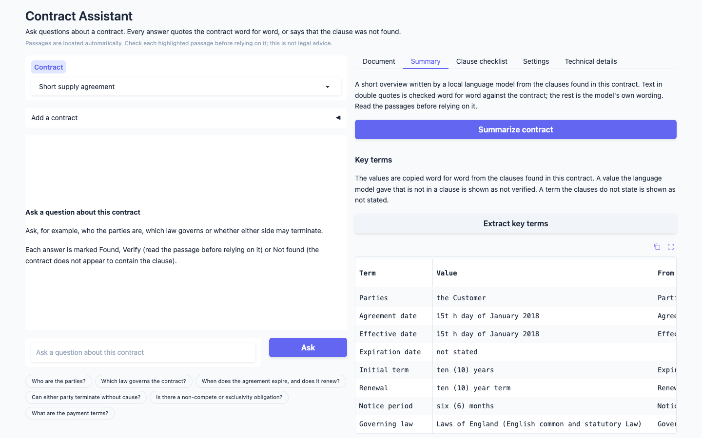
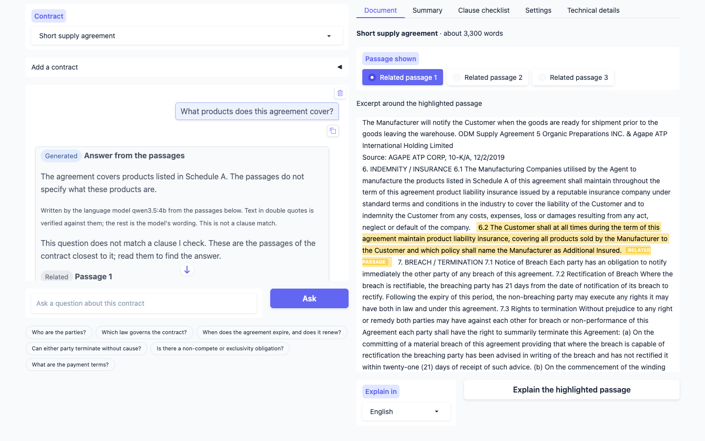
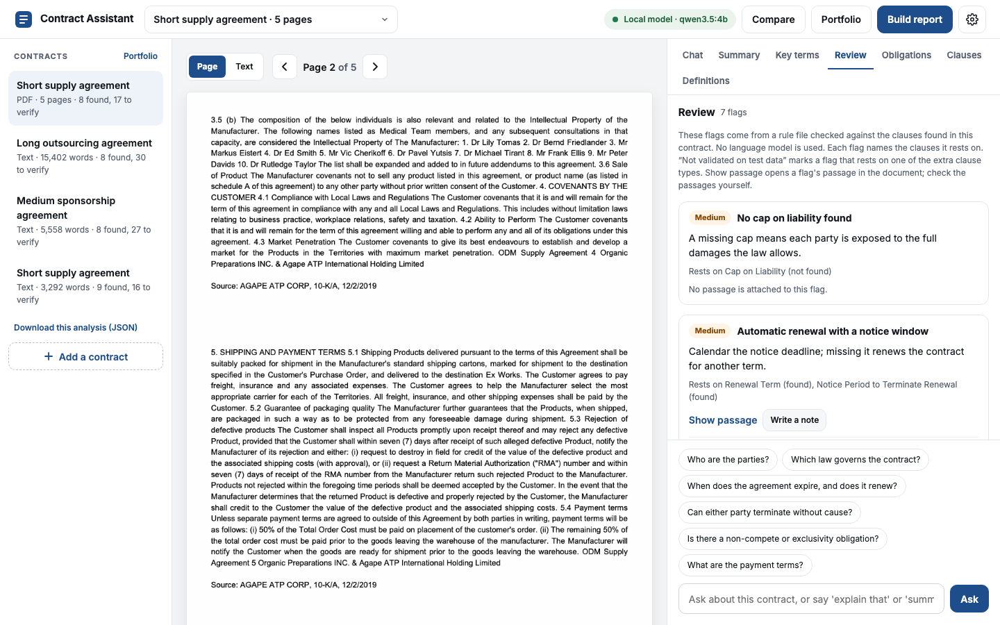
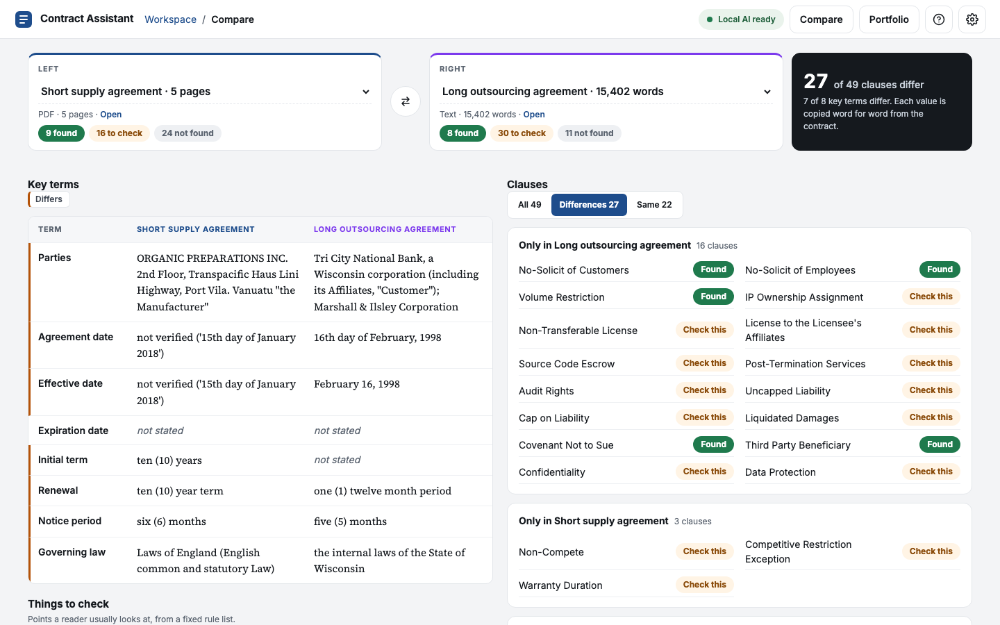

# contract-assistant

A local legal assistant for one contract at a time: upload a contract, ask questions in
plain language, get **verbatim quotes with a page number and a confidence** — or an
explicit *"not found"*.

The expensive model (a fine-tuned 150M-parameter encoder, trained in the companion
`cuad-encoder` repo) runs **once at upload** and extracts all 41 CUAD clause types with
character offsets. Every later question is a cache lookup: a router only maps the question
to clause types and never writes legal content. One local model, qwen3.5:4b served by
Ollama, routes the questions (constrained to the clause type names) and writes the generated
text; without Ollama an embedding router (bge-base-en-v1.5) routes instead. Quotes are verified against the source text before they
are shown.

The app also checks eight common clause types that CUAD does not have (Payment Terms,
Delivery, Confidentiality, Indemnification, Termination For Breach, Force Majeure, Dispute
Resolution, Data Protection). They are asked with CUAD's question template and the same
extractor, without retraining, and are never marked Found because no gold data exists to
validate their thresholds. A question that matches no clause type gets up to three related
passages of the contract, shown verbatim and labelled as not a clause match.

The chat remembers the earlier questions of a conversation, so follow-ups such as "and the
notice period?" or "explain that" work. A question about a defined term ("What is an RMA?")
is answered with the sentence of the contract that defines it, without any model.

The app can also write a short summary from the clauses it found, fill in a term sheet of
key terms, restate one clause in plain English or Serbian, and answer a question that
matches no clause from the passages closest to it. This text is generated and labelled as
such. Quotes inside it are verified against the contract.

## Install

Python 3.12.

```bash
uv venv && uv pip install -e ".[dev]"     # or: python -m venv .venv && pip install -e ".[dev]"
cp .env.example .env
```

The report export needs `python-docx`, which is a dependency. The `api` extra (`openai`) is optional. The Makefile expects the environment in `.venv/`.

The language model router needs Ollama and the model. This step is optional:

```bash
brew install ollama && brew services start ollama
ollama pull qwen3.5:4b      # routing, summaries, key terms, explanations and answers
ollama pull qwen3:1.7b      # optional: the comparison row of the router evaluation
```

`LLM_BACKEND` in `.env` selects the router: `ollama` (default), `openai` (an
OpenAI-compatible endpoint, set by `OPENAI_BASE_URL`, `OPENAI_API_KEY` and `LLM_MODEL`;
needs the `api` extra) or `none`, which routes with the embedding router only. If Ollama is
not running or the model is not pulled, the app logs a warning and uses the embedding
router alone. When the LLM fails on a single question, the embedding router routes that
question.

`GEN_MODEL` (default `qwen3.5:4b`), `GEN_TIMEOUT_S` (120) and `GEN_NUM_CTX` (8192) select
the generation model. It uses `LLM_BACKEND` like the router. The router and the generation
use the same model by default, which keeps one model in memory on a 16 GB machine.
`LLM_MODEL` may name another router model. The Ollama client sends the JSON schema as a
grammar where the runner supports it (llama.cpp) and puts it into the prompt where it does
not (the MLX runtime in the Homebrew build), and it validates the reply either way.
`GEN_NUM_CTX` is the context size of both clients. Without the generation model the app runs
with the Summary and Explain buttons off.

## Model weights

The fine-tuned 150M extractor is the one manual step: download it from the Kaggle run
output and unzip it to `models/ettin-150m-cuad-seed3407/` (gitignored). The folder must
contain `config.json`, `model.safetensors`, `tokenizer.json` and `tokenizer_config.json`.

Without the model the app still opens the three demo documents from their caches. Uploading
a new contract needs the model, and the app says so.

## Run

```bash
make demo         # http://127.0.0.1:7860
make ui-dev       # fake backends, no model, reloads on save
make test         # fast tests
make lint         # ruff
make router-eval  # router-eval --router llm --split test
make e2e          # e2e-eval --router llm
make summary-eval # summary-eval
make term-sheet-eval # term-sheet-eval
make passage-eval # passage-eval
```

`serve` prepares the summaries and key terms of the cached contracts in the background at
start-up and after an upload; `serve --no-precompute` turns it off. Generated text appears in
the web app as it is written and is checked when complete. A Stop button cancels a running
request.

The first `make demo` loads the embedding model and downloads it if it is not cached. With
Ollama, the app loads the router model at start-up (up to 120 s) and keeps it loaded for 30
minutes, because a cold load takes longer than the 10 s limit per question.
`make ui-dev` is meant for the VS Code Simple Browser.

`ask` answers a question about a document, a cache file or a `sha256:` document id:

```bash
contract-assistant ask demo/short_supply_agreement.txt \
    "who are the parties and which law governs?"
contract-assistant ask demo/short_supply_agreement.txt --types "Governing Law,Exclusivity"
contract-assistant ask demo/short_supply_agreement.txt "What is an RMA?"
contract-assistant definitions demo/long_outsourcing_agreement.txt
```

With a question, the router picks the clause types; `--router embedding|llm` asks for one
router and fails if it is not available. `--types` names the clause types and loads no
model. `--json` prints the answer as JSON. A question that matches no clause type prints
related passages instead. A question about a defined term is answered from the contract's
own definition, with no router and no model; `--types` skips that lookup.
`definitions` prints the defined terms of a document as a table, or as JSON with `--json`.

The evaluations use the 41 CUAD clause types only:

```bash
contract-assistant router-tune                                 # embedding threshold, on dev
contract-assistant router-eval --router embedding --split test
contract-assistant router-eval --router llm --split test       # make router-eval
contract-assistant e2e-eval --router oracle                    # also embedding and llm
contract-assistant phrase-eval                                 # LLM paragraphs vs. the quotes
contract-assistant summary-eval                                # summaries vs. the quotes
contract-assistant term-sheet-eval                             # term sheets vs. CUAD's gold
contract-assistant passage-eval                                # answers vs. the passages
```

### Router evaluation

| router | model | F1 | out-of-scope acc. | exact-set acc. | median ms |
| --- | --- | ---: | ---: | ---: | ---: |
| embedding | BAAI/bge-base-en-v1.5 | 0.626 | 0.400 | 0.400 | 11 |
| llm | qwen3:1.7b | 0.666 | 0.800 | 0.500 | 189 |
| llm | qwen3.5:4b | 0.933 | 1.000 | 0.800 | 554 |

The test split has 30 questions. qwen3.5:4b is the default router on these numbers; the
embedding router at its tuned threshold (0.58) stays the fallback.

The other commands are `contract-assistant import-demo | extract | show | definitions | summarize | term-sheet |
review | compare | dates | portfolio | feedback | report | explain | check | serve`.
`extract` adds the extra clause types to an existing cache without re-extracting the 41.

## How answers read

Each requested clause type gets one of three tiers, from the extractor's confidence
(thresholds chosen on validation in `cuad-encoder`: τ_high = 0.91, τ_low = 0.06):

| tier | meaning |
|---|---|
| found | confidence at or above τ_high; the quote is shown with page and confidence |
| possible, verify | between τ_low and τ_high; the quote is shown, to be checked by the reader |
| not found | below τ_low; only the best candidate score is reported |

The eight extra clause types (see the introduction) are capped at *possible, verify*: their
thresholds were not validated, so the chat adds "Not validated on test data" and the clause
checklist lists them under "Other common clauses". A cache that was extracted without them
does not answer for them; `extract`, or uploading the contract again with *Analyze
contract*, adds the missing types and leaves the 41 CUAD types unchanged.

A quote is shown only if it matches the source text exactly; otherwise it is withheld.
Three answers on the short demo contract:

```
**Governing Law** — found · p. n/a · confidence 1.00
> This agreement shall be governed by the Laws of England (English common and statutory Law).

**Exclusivity** — possible, verify · p. n/a · confidence 0.41
> The Manufacturer grants exclusive rights to the Customer for the term of ten (10) years …

**Source Code Escrow** — not found (checked; best candidate 0.00)
```

When a question matches no clause type, the assistant searches the passages of the contract
(groups of sentences of 200 to 600 characters) with the embedding model and shows up to
three of them, labelled *Related*, with a note that they are not a clause match. A passage
is shown only if its cosine similarity to the question is at least 0.55. Each passage is a
slice of the document text, so the quotes stay verbatim. If no passage reaches the value,
the reply says that the question does not match a clause.

That is the command-line template. The demo documents are plain text, so there are no page
numbers (`p. n/a`); a PDF gives the page.

The web app labels the same tiers Found, Verify and Not found, shows each passage
highlighted in the contract, and lists all 49 clause types by topic in a clause checklist.
The thresholds and the model details are in their own tabs.

| | |
|---|---|
|  |  |
| A found answer, with the passage highlighted in the contract. | A passage the reader should verify. |
|  |  |
| An explicit not found: the clause was checked. | One question answered for two clause types. |
|  |  |
| The Summary tab, written from the clauses found. | The highlighted passage restated in plain Serbian. |
|  |  |
| The key terms, each a verbatim value from a clause found. | A question outside the clause types, answered from the related passages. |
|  |  |
| Review flags from the rule file, each resting on a clause found. | Two contracts side by side, differing rows marked. |

### Defined terms and chat commands

Defined terms are found by pattern: `("Term")`, `(the "Term")` and `"Term" means ...`. The web
app lists them in the Document tab under "Defined terms". A definition question is answered
from the defining sentence, verbatim with its page, and labelled Definition.

| command | effect |
|---|---|
| `explain that`, optionally `in Serbian` | restates the last passage shown |
| `summarize`, `summary of this contract` | writes the summary into the chat |

Both are generated and labelled as such. The router sees the last four turns of the
conversation and resolves references to them. The evaluations still score single questions.

## Summary, key terms and explanations

The summary is written by the generation model only from the Found and Verify quotes of the
contract, never from the full text. Every passage in double quotes must match a verified
quote word for word, and every number in it must appear in one of those quotes (a number
written in words with its digits, like "six (6)", counts as one number), or the whole summary
is withheld with the reason. The app and the command line then ask the model once more
before giving up. The clause types it used are listed under it. A shown
summary is saved under `cache/summaries/` per contract, model and thresholds, so a change of
the sliders writes a new one; a withheld one is not saved, so the next request asks the
model again.

The summary can be written in Serbian: the web app has a "Summary in" dropdown, the command
line has `summarize --language sr`, and the chat understands "summarize in Serbian". The
quotes stay in English. The Serbian summary is saved apart from the English one. On an Apple M4 with 16 GB, qwen3.5:4b takes about 15 to 25 s for a demo
contract, at about 27 tokens per second.

The term sheet fills in eight key terms: parties, agreement date, effective date,
expiration date, initial term, renewal, notice period and governing law. The generation
model picks each value from the quotes of the clauses found, and each value is copied word
for word from the quote of one clause and located in the contract with its offsets. A value
the model gave that is not in a clause is shown as "not verified" with what the model
wrote. A term the clauses do not state is "not stated". A value taken from the clause of
another field names that clause. A term sheet is saved under `cache/term_sheets/`. The web
app shows it as a table and offers the JSON. On the command line, `term-sheet a.txt b.txt`
prints one column per document, which is the comparison.

When a question matches no clause type, the language model writes up to three sentences
from the related passages. The same checks as for the summary apply: quoted text is
verified and numbers are checked, with one corrected retry, or the answer is withheld with
the reason. The chat labels it Generated and says it is not a clause match. This is the
free-answer option that was left out on 18 October 2026 for breaking the verbatim
guarantee. It is now added behind the checks and the label.

The web app streams the summary, the explanation and the answer from passages. The text
shown is final only after the check at the end: a first reply that fails the check is
replaced by the second attempt.

The explanation restates one highlighted passage in at most two sentences, in English or
Serbian. It is withheld when it quotes text that is not in the clause or names a number the
clause does not. The web app labels it as a restatement, not a quote. The model can still
misstate what the clause means, so the reader checks it against the highlighted passage.

```bash
contract-assistant summarize demo/short_supply_agreement.txt
contract-assistant summarize demo/short_supply_agreement.txt --language sr
contract-assistant explain demo/short_supply_agreement.txt --type "Governing Law" --language sr
contract-assistant term-sheet demo/short_supply_agreement.txt demo/long_outsourcing_agreement.txt
contract-assistant term-sheet demo/short_supply_agreement.txt --json
```

`summarize` reads the saved summary when there is one; `--fresh` asks the model again.
`--json` prints either result as JSON.

`summary-eval` summarizes the three demo contracts as the app does, with the one corrected
retry, and writes `eval/results/summary_<model>.json`. It records per document the number of
items, characters, sentences, quoted spans, unfaithful spans, whether the summary was
withheld, the attempts it took, and the latency.

`term-sheet-eval` compares each value with CUAD's gold spans of the demo contracts in
`demo/demo_documents.json` and counts the values that agree, the rejected values and the
missing ones. It writes `eval/results/term_sheet_<model>.json`. `passage-eval` asks the ten
out-of-scope evaluation questions on the three demo contracts and counts the answers
shown, the withheld ones and the questions without passages. It writes
`eval/results/passages_<model>.json`.

## Review, comparison and report

The review flags come from `data/review_rules.json`: 18 rules of four kinds. A rule flags a
clause type that is missing, present, present together with others (all present), or present
without another one (present without). The check is rule-based and uses no model. Each flag
shows the clauses it rests on, with their quotes. A flag that rests on one of the extra
clause types is marked as not validated. The file can be edited; a rule that names an
unknown clause type is rejected with a message at start-up.

The Compare tab and `compare a b` put the key terms and the clause checklist of two
contracts side by side. Rows that differ are marked with "≠". The clause table needs no
model. The key terms need the two term sheets, which are read from the saved ones or
written with the generation model; without a model, only the clause table is printed.

The report gathers the summary, the key terms, the review flags, the clauses found with
their quotes and pages, and the defined terms, with a disclaimer. It is written as DOCX and
as Markdown from the saved parts: nothing is generated, and a missing summary or key terms
list is noted and left out.

```bash
contract-assistant review demo/short_supply_agreement.txt
contract-assistant compare demo/short_supply_agreement.txt demo/long_outsourcing_agreement.txt
contract-assistant report demo/short_supply_agreement.txt
```

`review` and `compare` take `--json`; `compare` takes `--fresh` to ask the model again.
`report` writes to `cache/reports/` unless `--out` names a folder.

## Key dates, portfolio and feedback

Key dates are read from the key terms. A stated date is parsed. The end of the initial
term, the end of the first renewal and the last day to give notice are computed from the
durations in the key terms, and each one shows its formula. The dates are only as good as
the key terms they come from, so the reader checks them against the contract. `dates` reads
the saved key terms; when there are none, it writes them with the generation model first.

The Portfolio tab and `portfolio` list every analysed contract with its size, the number of
clauses found, to verify and not found, the key terms, and the number of high, medium and low
flags. The key terms come from the saved term sheets; no model runs. `--csv` writes the
table to a file.

The thumbs up and down under a chat answer are stored in `cache/feedback.jsonl`, one line
each, and `feedback` lists them. They never leave the computer.

```bash
contract-assistant dates demo/short_supply_agreement.txt
contract-assistant portfolio --csv portfolio.csv
contract-assistant feedback
```

`dates`, `portfolio` and `feedback` take `--json`.

## Demo documents

Three CUAD contracts with pre-extracted caches: see [demo/README.md](demo/README.md).

The end-to-end table is `eval/results/e2e.md`. It has the oracle-router rows, which route by
the gold clause types and so show the extractor and the tiers without routing errors.

## Repository layout

This is its **own repository**, a sibling of the thesis repo — not a subfolder of it:

```
~/Desktop/cuad-encoder/         training, evaluation, thesis figures   (produces the model)
~/Desktop/contract-assistant/   this application                       (consumes it)
```

Separate git history, separate virtualenv.

## Relationship to `cuad-encoder`

| from `cuad-encoder` | into here |
|---|---|
| fine-tuned extractor (local folder) and its run tag | `EXTRACTOR_MODEL_ID`, `EXTRACTOR_NAME` |
| operating thresholds (val-selected) | `TAU_LOW`, `TAU_HIGH` |
| 41 clause types + CUAD's question wording | `data/clause_types.json` |
| inference core + sliding-window guard | vendored, with a parity test |
| CUAD's span match rule | `contract_assistant/cuad_match.py`, vendored |
| test predictions of the chosen run | demo caches, via `contract-assistant import-demo` |

Training, evaluation against published CUAD numbers, and the thesis figures stay in
`cuad-encoder`.
